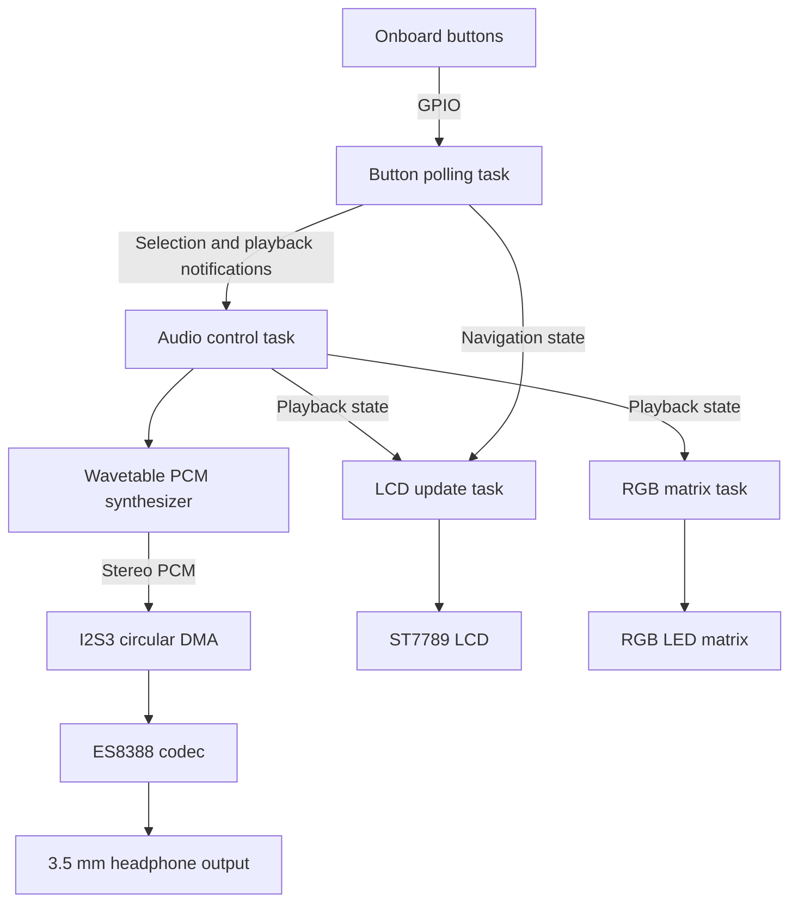

# RT-Spark STM32 FreeRTOS Personal MP3 Player


## Overview

This project is a Personal MP3 Player developed for **BCA182 Laboratory Activity 2** on the **RT-Spark** board, which uses an **STM32F407ZGT6** ARM Cortex-M4 microcontroller.

Instead of decoding compressed audio files, the firmware synthesizes notes in real time. It renders stereo PCM audio and streams it to the onboard **ES8388** codec over I2S using DMA. FreeRTOS tasks keep audio control, button input, the LCD, and the RGB matrix responsive during playback.

## Features

- **Eight selectable melodies** from the course song catalog. The catalog contains two additional course song definitions that are not part of the current eight-song selector.
- **Real-time audio synthesis** with a phase-accumulator wavetable synthesizer at 44.1 kHz.
- **FreeRTOS task-based application** for button polling, audio control, LCD updates, and RGB matrix updates.
- **ST7789 LCD interface** showing the current track, selection list, and playback state.
- **RGB LED matrix effects** that reflect playback, pause, selection, and confirmation states.
- **Circular DMA audio output** to the ES8388 codec.
- **Playback controls** for browsing, selecting, pausing, resuming, and stopping playback.

## Hardware

- RT-Spark development board with STM32F407ZGT6
- Wired headphones connected to the onboard 3.5 mm audio jack

### Onboard interfaces

| Peripheral | Interface | Purpose |
| --- | --- | --- |
| ES8388 codec | I2C2 control; I2S3 audio with DMA | Audio output |
| ST7789 LCD | FSMC parallel interface | Player interface |
| RGB LED matrix | GPIO and timer/PWM driver | Playback and navigation feedback |
| Onboard buttons | GPIO inputs | Playback and track navigation |

Headphone volume is currently configured in firmware through the ES8388 registers. The current firmware does not implement potentiometer/ADC volume control.

## Software architecture

The project uses PlatformIO, STM32Cube HAL, and FreeRTOS. The audio controller sequences song events and updates the synthesizer while the DMA audio stream runs. The LCD and matrix tasks provide visual feedback, and the button task handles debounced controls and navigation.



### FreeRTOS tasks

- `polling_buttons`: samples and debounces the onboard buttons, updates song navigation, and notifies the audio controller.
- `adjust_volume`: despite its legacy task name, hosts the audio-control loop and handles audio test controls. It does not currently read an ADC potentiometer.
- `update_lcd_leds_thread`: updates the LCD track list, selected/current track, playback status, and feedback.
- `led_matrix_thread`: renders playback, pause, selection, and confirmation effects on the RGB matrix.

## Project structure

```text
.
|-- include/
|   |-- audio_start_gate.h
|   |-- audio_synth.h
|   |-- FreeRTOSConfig.h
|   |-- led_matrix.h
|   |-- led_matrix_effect.h
|   |-- song_catalog.h
|   |-- song_def.h
|   |-- song_pcm.h
|   |-- song_player.h
|   |-- song_selection_state.h
|   `-- st7789_lcd.h
|-- src/
|   |-- audio_synth.cpp
|   |-- led_matrix.cpp
|   |-- main.cpp
|   |-- song_catalog.cpp
|   |-- song_pcm.cpp
|   |-- song_player.cpp
|   |-- song_selection_state.cpp
|   `-- st7789_lcd.cpp
|-- test/
|   `-- test_main.cpp
`-- platformio.ini
```

## Build and upload

### Prerequisites

- PlatformIO Core or the PlatformIO IDE extension
- ST-Link connection to the RT-Spark board

Open the project directory in VS Code, connect the board, then run:

```sh
pio run
pio run -t upload
```

The upload command flashes the firmware to the connected board.

## Controls

- **Down:** move down the track list.
- **Left/Right:** move across the track list.
- **Hold Right:** confirm and play the selected track.
- **Up:** play or pause.

The LCD displays the current track, selected track, and playback state. The RGB matrix provides corresponding visual feedback.

## Verification

The project includes native tests for song catalog mapping, event sequencing, PCM rendering, the synthesizer, navigation, and LED matrix effects. Build and run them with:

```sh
pio test -e native
```

The project owner reports that audio playback, LCD output, RGB matrix feedback, and button navigation have been tested on the RT-Spark hardware. A successful firmware build or native test run does not replace testing on the physical board.

## Troubleshooting

| Symptom | Checks |
| --- | --- |
| No audio | Check the headphone connection and confirm that ES8388 I2C initialization and I2S/DMA startup succeed. |
| Low volume | The current output level is set by the ES8388 headphone-volume register values in `src/main.cpp`. There is no ADC potentiometer control in the current firmware. |
| Blank LCD | Check board power and the LCD initialization path in `src/main.cpp` and `src/st7789_lcd.cpp`. |
| Buttons do not respond | Check the button GPIO mapping and the polling/debounce task in `src/main.cpp` and `src/song_selection_state.cpp`. |

## Credits

- **Course materials:** song data and sequencing concepts are based on the Module 8 laboratory materials (`song.h` and `song_def.h`).
- **RTOS:** FreeRTOS.

 